  

  
  
  
  

Trabalho com **infraestrutura e suporte de TI** em ambientes Microsoft, com foco em gestão de identidades, automação e segurança. Formado em Análise e Desenvolvimento de Sistemas, estou estudando cloud e automação com IA e buscando uma vaga de **Analista de Infraestrutura Júnior**.

         

### Projetos em destaque

| Projeto | O que é |
|---|---|
| 🪟 **[Automação Windows 11](https://github.com/Lucas-Amaralz/Automacao-windows1)** | Provisionamento automatizado de equipamentos Windows com Autounattend.xml e scripts .bat, **sem nenhuma senha no pendrive**. |
| 🏠 **[Portfólio jogável](https://github.com/Lucas-Amaralz/portfolio)** | Uma história interativa que termina no meu currículo, feita com HTML, CSS e JavaScript puro. **[Jogue aqui](https://lucas-amaralz.github.io/portfolio/)**. |
